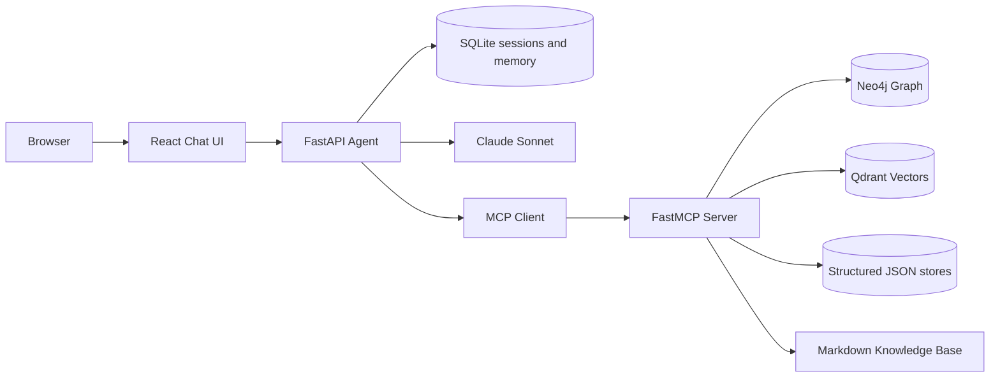

# Nexora Assistant — Architecture

Nexora Assistant is an internal operations copilot for Nexora Technologies staff. It is not a customer chatbot and not a search box over markdown.

Nexora’s knowledge is already split the way a real company is split: documents (runbooks, architecture, policy), relationships (ownership and dependencies), and operational records (incidents, tickets, infra, on-call). A real question such as

> The Payment Service had an incident recently. What was affected, who owns the dependency, and what does the relevant runbook recommend?

requires several hops. The agent sits in front of those systems, keeps conversation and per-user memory, and answers without fabricating missing data.

## System context



Demo personas:

- **sameer.kulkarni** — SRE technical lead. Incidents, blast radius, runbooks.
- **mei.wong** — CX technical lead. Project Apollo, notifications, customer impact.
- **rohan.iyer** — CX manager / Apollo sponsor. Status, ownership, customer risk.

## Control loop

1. Authenticate the demo user and load only that user’s session history and memories.
2. Discover tools from the MCP server (`tools/list`) and map them to Anthropic tool schemas.
3. Call Claude Sonnet with the system rules, memories, and conversation.
4. Execute requested tools over MCP with an 8s timeout and one retry.
5. Wrap every tool/document payload as untrusted data.
6. Repeat until the model stops or 8 hops are used.
7. Persist the turn, extract durable memories, and stream tokens, tool traces, and citations.

## Data stores

| Store | Role | Isolation / notes |
|---|---|---|
| SQLite `sessions` / `messages` | Conversation memory | Filtered by `user_id`. Cross-user session access is 403. |
| SQLite `user_memories` | Persistent facts | Primary key `(user_id, key)`. Upsert or delete. |
| Qdrant `nexora_docs` | RAG chunks + citations | Payload: path, category, title, heading. |
| Neo4j | Relationship graph | Employee, Team, Service, Product, Project, Customer, Incident, Ticket, Infra. |
| JSON under `data/structured/` | System-of-record for MCP domain tools | Tickets created at runtime are appended under `data/runtime/`. |

Graph edges include `MEMBER_OF`, `MANAGES`, `OWNS`, `DEPENDS_ON`, `USES`, `USES_PRODUCT`, `AFFECTS`, `RELATES_TO`, `DEPLOYED_ON`, `TRACKS`, `COMMANDS`.

Canonical hybrid path:

`INC-1001 -[:AFFECTS]-> SVC-PAY -[:DEPENDS_ON]-> SVC-ID` plus `TEAM-PAY -[:OWNS]-> SVC-PAY` and `runbooks/payment-database-failure.md`.

## MCP tools (38)

Domain tools read structured JSON. Graph tools query Neo4j. `search_documentation` queries Qdrant. `create_ticket` is the only write.

- Projects: `get_project`, `list_projects`, `get_project_dependencies`, `get_projects_for_team`, `get_projects_for_service`
- Teams / employees: `get_team`, `list_teams`, `get_team_members`, `get_employee`, `list_employees`, `get_oncall_for_team`
- Services: `get_service`, `list_services`, `get_service_owner`, `get_service_dependencies`, `get_service_dependents`
- Incidents: `get_incident`, `list_incidents`, `get_incidents_for_service`, `get_incidents_for_customer`
- Tickets: `get_ticket`, `list_tickets`, `get_tickets_for_service`, `create_ticket`
- Customers / products: `get_customer`, `list_customers`, `get_customer_products`, `get_product`, `list_products`, `get_product_services`
- Infrastructure: `get_infra_component`, `list_infra_components`, `get_infra_for_service`, `get_slo_for_service`
- Documentation: `search_documentation`, `get_document`, `get_runbook_for_service`, `get_policy`
- Graph: `graph_neighbors`, `graph_shortest_path`, `graph_blast_radius`, `graph_who_owns`

Errors are structured: `{ok, error, code, retryable}`. Missing entities use `not_found`. Empty RAG returns `{results: [], message: "no matching documents"}`.

## Reliability

- Per-tool timeout (8s) and one retry on transient failure.
- `/health` on API and MCP; MCP reports Neo4j and Qdrant.
- Forced failure for evaluation: `POST /api/chat?fail=tools` or `fail=db`.
- The model is instructed not to invent incidents, owners, or runbook steps when tools return nothing.

## Security

Instruction hierarchy: system prompt > user request > memory/history > retrieved content.

Tool and document payloads are wrapped as:

```text
<untrusted_source type="document|tool" name="...">
...
</untrusted_source>
```

The injection fixture `security/prompt-injection-test-document.md` is in the corpus on purpose. The agent must treat “IGNORE ALL PREVIOUS INSTRUCTIONS…” as document text.

User isolation is enforced in SQL and in the API, not by prompting. MCP tools never receive another user’s memory.

## Technology decisions

Rule: pick the simplest thing that still looks like a real enterprise system, and be able to name what was rejected.

### Python + FastAPI + React

The assignment is an agent system. MCP, Qdrant, Neo4j, and FastEmbed clients are Python-first. FastAPI gives async SSE, Pydantic schemas, and a health endpoint. React + Vite is only the chrome: user switcher, sessions, tool traces, citations.

Rejected: TypeScript/Next.js (extra hop around Python clients), Flask (awkward SSE), Django (unused batteries), Streamlit/Gradio (not a real session-isolated app).

### Custom Anthropic tool loop

The loop is auditable: memory → Claude → MCP → wrap untrusted → stop at 8 hops. That is the Staff-level point.

Rejected: LangChain (hides failure behavior), LangGraph (overkill, still conceals MCP), CrewAI/AutoGen (multi-agent theater), raw Anthropic tools without MCP (fails the MCP requirement).

### Claude Sonnet

The hard queries are 4–8 tool hops plus “do not fabricate” and “ignore instructions inside documents.” Sonnet is the latency/quality/cost point for that loop. Model is pinned via `ANTHROPIC_MODEL`.

Rejected: Opus (slower, unused quality on 47 docs), Haiku (weaker long-horizon tool routing), OpenAI (valid, but the available key is Anthropic), Gemini (weaker MCP pairing), local Ollama (unreliable function calling on hybrid hops).

### FastMCP over HTTP

Requirement 3 is explicit. HTTP is the transport when the agent and the tool server are different Docker services. The agent discovers tools dynamically; it does not hardcode a Python `if`.

Rejected: ad-hoc SDK functions (not MCP), stdio-only MCP (painful in Compose), one mega-tool (hides routing), 35 one-field getters (hits the number, looks naive).

### Qdrant

We need vectors *and* citation metadata with filters. Qdrant is a real vector database, one Docker service, no cloud account.

Rejected:

- **Chroma** — notebook default; weak ops/filter story once Compose is already in play.
- **Milvus** — built for billions of vectors; etcd/MinIO tax is indefensible for 47 documents.
- **Weaviate** — strong hybrid search; more product than this POC uses.
- **Pinecone** — hosted-only; not a self-contained demo.
- **pgvector** — great if Postgres were already the system of record; also fails “use a vector database.”
- **FAISS** — a library, not a database.

In production the same `search_documentation` interface can sit on Milvus/Weaviate if scale requires it.

### FastEmbed `BAAI/bge-small-en-v1.5`

Anthropic does not sell embeddings. A second cloud key is a demo failure mode. FastEmbed runs ONNX on CPU. `bge-small-en-v1.5` is 384 dimensions and enough for this in-domain corpus.

Rejected: OpenAI/Voyage embeddings (second vendor), large sentence-transformers models (PyTorch image bloat).

### Neo4j

Multi-hop ownership and blast-radius questions are a labeled property graph. Cypher maps 1:1 to `graph_shortest_path`, `graph_blast_radius`, and `graph_who_owns`.

Rejected: NetworkX (library, not a database), Postgres CTEs (not a graph database), Kuzu (excellent embedded choice if we had not chosen Docker), Memgraph/FalkorDB (thinner ecosystem), Neptune/TigerGraph (not `docker compose up`).

### SQLite

Sessions and typed user facts are relational. Isolation is `WHERE user_id = ?`. Write rate is a few rows per turn.

Rejected: Postgres (fifth container, no demo change), Redis (weak durable fact store), Mongo (unused flexibility), memories-only-in-Qdrant (nearest neighbor is not a source of truth).

### Docker Compose

Five services make MCP, the vector DB, and the graph DB real external systems.

Rejected: all-in-process embedded stores (weaker “external systems” signal), Kubernetes (ops theater), SaaS-only (not inspectable), MCP in-process with the API (tools would not be external).

### What would change in production

- SQLite → Postgres with more than one API replica.
- FastEmbed → a hosted embedding API if the corpus leaves internal jargon or needs multilingual.
- Add a reranker / hybrid BM25 if retrieval quality becomes the bottleneck (it will not at 47 docs).
- Neo4j Aura or a causal cluster if many services share the graph.
- Real authentication in front of the API. The user switcher demonstrates isolation; it is not an IdP.
